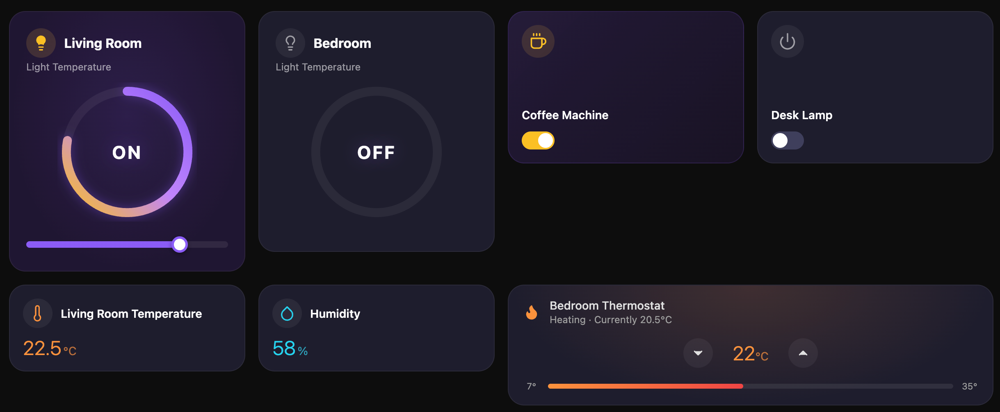

# Dashboard Cards for Home Assistant

A collection of custom Lovelace cards for Home Assistant with a refined dark aesthetic, glowing accents, and smooth transitions. Installable via [HACS](https://hacs.xyz/).



## Cards

| Card | Element | Description |
|------|---------|-------------|
| Light | `custom:dashboard-light-card` | Brightness control with colour-matched glow |
| Switch | `custom:dashboard-switch-card` | Toggle with status dot and colour accents |
| Sensor | `custom:dashboard-sensor-card` | Read-only display for temperature, humidity, motion, etc. |
| Climate | `custom:dashboard-climate-card` | Thermostat with target temperature and heat progress bar |
| Weather | `custom:dashboard-weather-card` | Current conditions with multi-day forecast |
| Media Player | `custom:dashboard-media-player-card` | Transport controls, volume slider, animated equaliser |
| Fan | `custom:dashboard-fan-card` | Fan speed control |
| Camera | `custom:dashboard-camera-card` | Live camera feed |
| Doorbell | `custom:dashboard-doorbell-card` | Doorbell with camera stream |
| Person | `custom:dashboard-person-card` | Person presence and location |
| Scene | `custom:dashboard-scene-card` | One-tap scene activation |
| Shopping List | `custom:dashboard-shopping-list-card` | Interactive shopping list |

## Installation

### HACS (Recommended)

1. Open **HACS** > **Frontend** > **Custom Repositories**
2. Add this repository URL with category **Lovelace**
3. Install **Dashboard Cards**
4. Restart Home Assistant

### Manual

1. Download `ha-dashboard-cards.js` from the [latest release](../../releases/latest)
2. Place it in `/config/www/`
3. Go to **Settings** > **Dashboards** > **Resources** and add `/local/ha-dashboard-cards.js` as a JavaScript Module

## Usage

Add cards to your Lovelace dashboard via YAML or the visual editor:

```yaml
type: custom:dashboard-light-card
entity: light.living_room
name: Living Room

type: custom:dashboard-switch-card
entity: switch.coffee_machine
name: Coffee Machine
icon: coffee
active_colour: amber

type: custom:dashboard-sensor-card
entity: sensor.living_room_temperature

type: custom:dashboard-climate-card
entity: climate.bedroom
step: 0.5

type: custom:dashboard-media-player-card
entity: media_player.living_room_tv

type: custom:dashboard-weather-card
entity: weather.home
show_forecast: true
num_forecasts: 5
```

## Development

```bash
npm install       # install dependencies
npm run build     # bundle to dist/ha-dashboard-cards.js
npm run watch     # rebuild on changes
npm run typecheck # run TypeScript type checking
npm run lint      # lint with Biome
```

Built with [Lit](https://lit.dev/) and TypeScript. Bundled with Rollup into a single JS file.

## Licence

[MIT](LICENSE)
